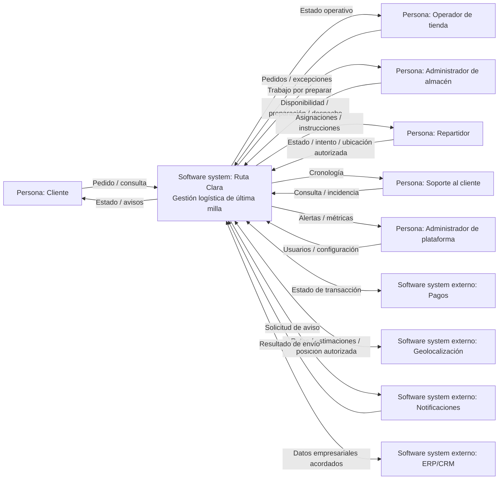
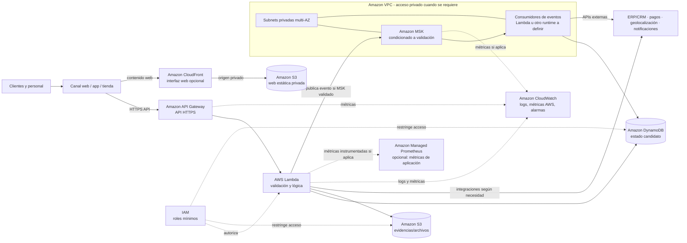

# Propuesta inicial de arquitectura AWS

> Esta propuesta extiende el diagnóstico de contexto. Es una hipótesis académica para orientar validaciones; no es una arquitectura aprobada para producción ni una selección final de servicios.

## 1. Resumen ejecutivo

**Producto:** Ruta Clara, plataforma de gestión logística de última milla.

**Problema:** una empresa de retail digital recibe pedidos desde varios canales, mantiene inventarios distribuidos y coordina almacenes, rutas y repartidores sin una vista centralizada y confiable del estado de cada pedido. La duplicación y desactualización de información produce fallos, retrasos, costos operativos y pérdida de trazabilidad.

**Usuarios:** clientes, operadores de tienda, administradores de almacén, repartidores, soporte y administradores de plataforma. Los sistemas externos son pagos, geolocalización, notificaciones y ERP/CRM.

**Objetivo general:** ofrecer una vista operativa consistente del ciclo del pedido y facilitar coordinación, seguimiento e investigación de incidencias.

**Alcance inicial:** recepción/consulta del pedido; validación coordinada de inventario; seguimiento de preparación, despacho y entrega; asignación operativa; registro de eventos e incidencias; integración conceptual con sistemas existentes.

**Fuera de alcance:** reemplazar ERP/CRM o pagos, diseñar optimización avanzada de rutas, definir esquema final de datos, fijar objetivos de disponibilidad/recuperación, elegir región/costos definitivos, detallar CI/CD o implementar código.

## 2. Problema de negocio

Pedidos, inventario y eventos logísticos viven en canales, almacenes y herramientas distintas. Sin una cronología única, personal de soporte y operaciones reconstruye manualmente lo ocurrido. Se pueden duplicar pedidos, reservar existencias que ya no están disponibles, asignar mal una ruta y avisar tarde al cliente.

El resultado es una combinación de entregas tardías/fallidas, reprocesos, reclamos, costos de soporte y dificultad para determinar dónde se originó una excepción. Una plataforma centralizada puede normalizar la consulta del estado, mantener una referencia operativa del pedido y hacer visibles las excepciones. No elimina por sí sola las causas: depende de datos correctos, integración y adopción por los equipos.

### Variables críticas

- Identidad idempotente del pedido en todos los canales.
- Fuente maestra, vigencia y reserva del inventario.
- Transiciones válidas y marcas de tiempo de los estados.
- Volumen normal y picos, tasa de eventos, pedidos por zona/canal.
- Calidad/conectividad de los dispositivos de operación y reparto.
- Dependencia y disponibilidad de ERP/CRM, pagos, mapas y mensajería.
- Acceso mínimo necesario a datos personales y ubicación.
- Línea base de entregas a tiempo, fallas, duplicados y contactos al soporte.

## 3. Actores y sistemas externos

| Actor/sistema | Tipo | Interacción | Información intercambiada |
|---|---|---|---|
| Cliente | Usuario | Crea pedido por canal existente o consulta seguimiento; recibe avisos. | Referencia del pedido, estado, ventana estimada, mensajes e incidencia reportada. |
| Operador de comercio/tienda | Usuario | Consulta pedidos y excepciones comerciales. | Pedido, canal, prioridad y estado operativo. |
| Administrador de almacén | Usuario | Confirma disponibilidad, preparación y despacho. | Existencias/ajustes, lista de preparación, despacho y excepción. |
| Repartidor | Usuario | Consulta asignaciones y reporta progreso/resultado. | Entregas, instrucciones mínimas, ubicación si se autoriza, intento y evidencia. |
| Soporte al cliente | Usuario | Investiga el pedido y registra resolución. | Cronología, motivo de incidencia y resolución. |
| Administrador de plataforma | Usuario propuesto | Gestiona acceso y configuración operativa. | Usuarios, roles, parámetros y alertas. |
| Sistema de pagos | Sistema externo | Devuelve el estado de autorización/captura según integración acordada. | Identificador de pedido/transacción y estado; no se presupone almacenar datos de tarjeta. |
| Geolocalización | Sistema externo | Consulta mapas/estimaciones o posición cuando aplique. | Origen/destino aproximados, coordenadas autorizadas, ruta/estimación. |
| Notificaciones | Sistema externo | Envía mensajes y reporta resultado cuando esté disponible. | Destinatario/canal, plantilla y estado de envío. |
| ERP/CRM interno | Sistema externo | Intercambia los datos empresariales que se acuerden. | Pedidos, inventario, clientes y referencias; fuente maestra por confirmar. |

## 4. Diagrama de contexto (C4 nivel 1)



Las relaciones son flujos de contexto; no implican protocolo ni sincronía. Pagos no procesa la logística, el proveedor de mapas no decide el estado del pedido y la plataforma no reemplaza ERP/CRM.

## 5. Arquitectura AWS inicial por capas

### Entrada y experiencia

- **Amazon CloudFront + Amazon S3**: distribución HTTPS de una posible aplicación web estática. Configurar el bucket de origen privado mediante Origin Access Control; CloudFront no debe convertir el bucket en público.
- **Amazon API Gateway**: API HTTPS para las aplicaciones y canales autorizados. Aplica autenticación/autorización, validación básica, cuotas y límites. CloudFront se usa para contenido web estático; solo se pondría delante del API si existe un motivo validado de distribución, protección o dominio común. Evitamos duplicar capas sin necesidad.

### Procesamiento

- **AWS Lambda**: funciones pequeñas para recibir solicitudes, validar reglas acotadas, persistir cambios y responder. Separarlas por responsabilidades de negocio si el flujo lo exige, no como microservicios por anticipado.
- Funciones Lambda que acceden a MSK u otros recursos privados se conectan a subnets privadas de una VPC y usan roles de ejecución dedicados. No se debe poner toda Lambda en VPC automáticamente: se habilita cuando necesite acceso privado. AWS administra el entorno de ejecución de Lambda; la VPC de la cuenta es para acceso a recursos propios.

### Eventos

- **Eventos desacoplados** ayudan a distribuir cambios como `PedidoAceptado`, `InventarioReservado`, `EntregaAsignada` y `EntregaActualizada`, sin que toda solicitud espere a todos los consumidores.
- **Amazon MSK (Kafka) es una opción condicionada, no requisito decidido.** Tiene sentido si la empresa necesita compatibilidad Kafka, alto volumen sostenido, varios consumidores independientes, retención/relectura y tiene capacidad para operarlo. Para una primera etapa de volumen/desacoplamiento desconocidos, validar antes de asumir MSK; un servicio de eventos/colas más gestionado y simple podría bastar.
- Si se elige MSK, los brokers quedan en subnets privadas; clientes permitidos en grupos de seguridad dedicados y autenticación/autorización de Kafka. Definir entrega al menos una vez, idempotencia, reintentos, eventos no procesables y retención. No prometer “exactly once” extremo a extremo.

### Persistencia y archivos

- **Amazon DynamoDB (candidato que falta en la lista original)** para estado operacional consultable del pedido e idempotencia, sujeto a confirmar patrones de acceso, consistencia, relaciones y transacciones. El sistema necesita persistencia estructurada para estado e inventario; S3 no es una base transaccional.
- Si ERP es la fuente maestra de inventario, la plataforma coordina/consulta esa fuente y almacena solo la vista o reserva acordada. No se decide todavía quién es dueño del dato.
- **Amazon S3** para evidencias de entrega, adjuntos, exportaciones y archivos históricos cuando sean necesarios. Bloquear acceso público, usar políticas IAM/bucket estrechas, cifrado y ciclo de vida acorde a retención. No almacenar secretos ni datos de pago sensibles como archivos.

### Red

- **Amazon VPC** en una región por elegir, con subnets privadas en al menos dos zonas de disponibilidad para recursos que requieran conectividad privada, por ejemplo MSK y Lambdas conectadas a VPC. VPC no significa que cada servicio AWS deba ubicarse dentro de subnets.
- **Subnets públicas** solo para componentes de red que requieran conectividad entrante/salida controlada, típicamente NAT Gateway si una Lambda privada debe llamar APIs externas de Internet. API Gateway, CloudFront, S3 y Lambda son servicios administrados y no se “instalan” en subnets públicas.
- Considerar VPC endpoints para S3 y otros servicios AWS usados desde la VPC para reducir exposición y dependencia de salida a Internet. El acceso a APIs externas se define con egress controlado según necesidad.
- **Security Groups** con reglas mínimas entre productores/consumidores y brokers; no abrir Kafka ni almacenes de datos a Internet.

### Seguridad

- **IAM**: grupos/roles para personas y roles de servicio para API Gateway/Lambda según sus acciones. Roles separados por función; permisos a recursos específicos. No usar credenciales de largo plazo ni un rol compartido con acceso amplio.
- Identidad de usuarios y clientes del API debe resolverse con un proveedor/autorizador por seleccionar; IAM no sustituye autenticación de usuarios finales.
- Secretos de integraciones se guardan en un almacén de secretos administrado, si las integraciones requieren credenciales; no en código, eventos o logs. Cifrado en tránsito y en reposo; auditoría y retención se definirán con requisitos.

### Observabilidad

- **Amazon CloudWatch** para logs estructurados de API/Lambda, métricas de servicios administrados, alarmas y paneles iniciales.
- **Amazon Managed Service for Prometheus (AMP)** es candidato solo si se decide instrumentar métricas de aplicación en formato Prometheus o existe una plataforma que lo aproveche. No es necesario para empezar a observar métricas nativas AWS: CloudWatch suele cubrir esa primera necesidad. Prometheus observa métricas, no reemplaza logs.
- Correlacionar por `order_id` no sensible y `correlation_id`; no registrar dirección completa, credenciales, datos de tarjeta ni coordenadas precisas sin justificación y controles.

## 6. Flujo principal de un pedido

1. El canal de comercio crea un pedido y envía la solicitud al API HTTPS; si es web estática, CloudFront entrega la interfaz desde S3 privado. El API no debe cachear respuestas personales de pedido.
2. API Gateway autentica/autoriza la llamada según el mecanismo que se valide y deriva la solicitud a Lambda.
3. Lambda valida formato, origen e idempotency key; consulta el dato de inventario en el sistema dueño acordado (ERP u otra fuente) y solicita/coordina la reserva.
4. Lambda escribe el estado operacional del pedido en el almacén estructurado candidato (DynamoDB) con condiciones de idempotencia. Si la reserva es externa, el resultado debe quedar registrado como estado pendiente/confirmado con manejo de fallo acordado.
5. Tras confirmar la escritura, se publica un evento de pedido para los consumidores. La publicación y persistencia forman un riesgo de doble escritura; el patrón de outbox/stream o estrategia equivalente se decide en diseño detallado, no se da por resuelto aquí.
6. El consumidor de planificación/asignación obtiene datos necesarios y calcula o solicita una ruta. El sistema de geolocalización aporta rutas/estimaciones; las reglas de asignación aún no se conocen.
7. La plataforma envía la asignación al canal/dispositivo del repartidor. El repartidor recibe destino e instrucciones mínimas y reporta despacho, intentos y resultado.
8. Las actualizaciones pasan por API Gateway/Lambda o el mecanismo móvil que se defina; se valida transición, se actualiza el estado y se genera el evento correspondiente. Si se eligió MSK, los consumidores acceden por red privada y manejan duplicados/reintentos.
9. Un consumidor solicita el envío al proveedor de notificaciones. Registra resultado de envío, no asume que el mensaje fue leído.
10. Soporte consulta la cronología y los estados desde la plataforma. CloudWatch recibe logs técnicos y métricas de API/Lambda/MSK; AMP recibe métricas de aplicación solo si se aprueba su uso.
11. S3 guarda evidencia/adjuntos cuando se requiera, enlazados por referencia al pedido, con controles de acceso y retención.

## 7. Red y seguridad iniciales

```text
Usuarios / canales
  ├─ HTTPS → CloudFront → S3 privado (interfaz estática, si aplica)
  └─ HTTPS → API Gateway → Lambda
                           ├─ DynamoDB (servicio administrado; acceso IAM)
                           ├─ S3 (objetos; acceso IAM/endpoints según diseño)
                           └─ VPC privada → MSK (si se valida)
                                  ├─ subnets privadas multi-AZ
                                  └─ egress/NAT solo si se necesitan llamadas a APIs públicas
```

- La API pública termina en API Gateway; no exponer funciones, brokers ni tablas directamente.
- Almacenes de eventos y recursos con conectividad privada usan subnets privadas. Subnets públicas alojan únicamente los elementos de conectividad que realmente requieren salida/entrada pública, no Lambda ni MSK.
- Security Groups limitan el tráfico por origen y puerto; por ejemplo, solo productores/consumidores autorizados pueden alcanzar listeners de Kafka.
- Cada Lambda recibe un rol separado con acceso mínimo a tablas, buckets y operaciones requeridas. En MSK se combina autorización de red con autenticación/autorización del clúster; la regla del Security Group no reemplaza permisos Kafka.
- Buckets S3 bloquean acceso público y conceden acceso a roles específicos; enlaces de descarga se autorizan y caducan si el caso lo requiere.
- Identidades de personas se asignan por función laboral; IAM Identity Center/SSO y proveedor de identidad de clientes son opciones a evaluar, no decisiones asumidas.
- VPC endpoints, cifrado, manejo de secretos, auditoría y protección de datos se detallan cuando se conozcan requisitos de cumplimiento y operación.

### Diagrama técnico AWS (propuesta inicial)



El diagrama muestra capacidades candidatas, no una topología aprobada. API Gateway es un servicio administrado y no se ubica dentro de las subnets de la VPC. Lambda solo se conecta a la VPC cuando necesita acceder a MSK u otro recurso privado. Para invocar APIs externas desde subnets privadas se debe definir egress controlado, por ejemplo NAT, según los contratos.

## 8. Logs, métricas y observabilidad

| Señal | Ejemplos | Destino inicial |
|---|---|---|
| Logs de aplicación estructurados | `order_id`, `correlation_id`, actor/servicio, transición, resultado, duración, código de error (sin PII innecesaria). | CloudWatch Logs |
| Métricas de API | Solicitudes, latencia, errores 4xx/5xx, throttling. | Métricas de API Gateway y alarmas CloudWatch |
| Métricas Lambda | Invocaciones, errores, throttles, duración y concurrencia. | CloudWatch |
| Flujo de pedidos | Pedidos aceptados/rechazados, fallidos, duplicados detectados y pedidos sin avance. | Métricas de aplicación; CloudWatch inicialmente, AMP si se valida Prometheus |
| Inventario | Fallos de reserva, discrepancias y tiempo de conciliación. | Métricas de aplicación y alarmas |
| Eventos | Publicados/procesados, demora de consumidor, reintentos, errores y mensajes no procesables. | Métricas de MSK si existe; CloudWatch y/o AMP según instrumentación |
| Entrega | Porcentaje a tiempo, retraso por etapa, intentos fallidos, entregas sin actualización. | Métricas de aplicación y panel operativo |
| Integraciones | Fallos y latencia de pagos, ERP/CRM, geolocalización y notificaciones. | Logs/métricas sin secretos; alarmas por dependencia |

Definir umbrales después de medir línea base. Para Prometheus usar métricas agregadas y cardinalidad controlada; no poner `order_id` como etiqueta de métrica. El identificador individual pertenece a logs/trazas.

## 9. Riesgos arquitectónicos

| Riesgo | Impacto | Probabilidad inicial | Mitigación/validación |
|---|---|---|---|
| Duplicación de pedidos | Doble preparación/cobro o confusión operativa. | Media | Clave idempotente del canal, restricción condicional de escritura, alertas y conciliación. |
| Inventario inconsistente | Venta sin existencias, cancelación y pérdida de confianza. | Alta | Acordar fuente maestra, reserva y conciliación; validar comportamiento concurrente con el sistema dueño. |
| Pérdida o doble procesamiento de eventos | Estado incompleto o acciones repetidas. | Media | Idempotencia de consumidores, reintentos y cola de fallidos; resolver doble escritura entre estado y evento. |
| Fallas de servicios o integraciones | Pedidos bloqueados y acumulación operativa. | Media | Timeouts, reintentos con límite, estado pendiente, reconciliación y operación manual acordada. |
| Problemas de seguridad/privacidad | Exposición de cliente, domicilio o ubicación. | Media | IAM mínimo, cifrado, autorización por rol, datos mínimos en logs y controles de retención. |
| Retrasos de entrega | Incumplimiento de promesa y más soporte. | Media | Medir retraso por etapa, registrar causa y habilitar reasignación según reglas validadas. |
| Pérdida de trazabilidad | No se puede explicar el estado o resolver reclamo. | Media | Cronología auditable, fuente/tiempo por evento y alertas ante pedido estancado. |
| Crecimiento fuera de control | Degradación, costo y operación difícil. | Media | Medir picos y consumidores; límites/cuotas, revisión de costos y justificar MSK solo con evidencia. |
| Dependencia de MSK sin capacidad operativa | Costo y complejidad no necesarios en etapa inicial. | Media | Comparar opción gestionada más simple; confirmar Kafka, volumen, replay, retención y equipo responsable. |

## 10. Supuestos

- Existe al menos un canal de comercio y un sistema empresarial que puede intercambiar pedidos/inventario, pero el mecanismo y la fuente maestra se desconocen.
- Existe un proveedor de pagos y se necesita conocer estado de transacción; la plataforma no recibe ni almacena datos de tarjeta.
- Geolocalización y notificaciones están disponibles como servicios externos potenciales; sus contratos y niveles de servicio no están confirmados.
- Repartidores cuentan con algún dispositivo móvil, aunque conectividad y modo sin conexión deben validarse.
- La plataforma necesita registrar el estado actual y una cronología, pero la retención exacta está pendiente.
- S3 guardaría objetos/evidencias, no el estado transaccional del pedido.
- DynamoDB se propone como candidato serverless para estado operativo; debe compararse con las necesidades relacionales y de consistencia antes de adoptarlo.
- Kafka/MSK se considera por el interés en eventos, pero no se presume imprescindible para el primer incremento.
- La aplicación web estática puede servirse desde S3/CloudFront; canales móviles/API pueden llamar al API directamente.
- Región AWS, residencia de datos, volumen, disponibilidad, RTO/RPO y presupuesto están por confirmar.

## 11. Decisiones iniciales: tomadas y por validar

| Estado | Decisión | Razón |
|---|---|---|
| Tomada para esta propuesta | Comenzar por el problema, límites y actores; no presentar esto como producción. | Corresponde al objetivo de diagnóstico. |
| Tomada para esta propuesta | Centralizar la vista operacional del pedido y su cronología. | Responde a falta de estado confiable y trazabilidad. |
| Propuesta inicial | API Gateway + Lambda para entrada/procesamiento de carga variable. | Reduce administración de servidores si el patrón real es compatible; no implica que toda lógica deba ser Lambda. |
| Propuesta inicial | S3 para objetos y contenido web estático, con CloudFront para distribución. | Separa archivos del estado transaccional y evita servir el bucket públicamente. |
| Propuesta condicionada | MSK para eventos si se justifican Kafka, múltiples consumidores, volumen/retención y capacidad operativa. | Kafka da capacidades útiles, pero introduce costo y responsabilidades; validar alternativa simple primero. |
| Propuesta candidata | DynamoDB como almacenamiento estructurado operacional. | Hace falta un almacén de estado e idempotencia; modelo, relaciones y consistencia aún deben probarse. |
| Propuesta de seguridad | VPC y subnets privadas solo para recursos que necesitan conectividad privada; Security Groups restrictivos. | Aísla MSK/recursos privados sin ubicar servicios administrados donde no corresponde. |
| Propuesta de seguridad | Roles IAM separados y mínimos para cada componente. | Limita el alcance de una credencial comprometida y permite auditar acceso. |
| Propuesta de observabilidad | CloudWatch como base; AMP solo si se requiere Prometheus para métricas de aplicación. | Evita operar dos plataformas de métricas antes de conocer la necesidad. |

## 12. Qué no se resuelve todavía

- Diseño detallado de base de datos, claves, índices, consistencia y retención.
- Elección definitiva de microservicios, límites de dominio, eventos y esquemas.
- MSK frente a alternativa más simple y diseño de particiones/retención.
- Alta disponibilidad objetivo, disaster recovery, región y RTO/RPO.
- Costos de AWS y dimensionamiento; faltan volumen, tráfico, retención y región.
- CI/CD, cuentas/ambientes, IaC, despliegue y estrategia de pruebas.
- Diseño detallado de rutas, asignación, modo desconectado y excepciones.
- Contratos de integración, autenticación de usuarios y requisitos legales/privacidad.
- Implementación de código y metas numéricas de SLA/SLO.

## Cómo explicar los diagramas en el video

**Contexto:** comienza por el rectángulo Ruta Clara y di que concentra la consulta de estado y coordinación. Recorre los actores humanos y luego los cuatro sistemas externos. Explica que las flechas muestran información, no tecnologías ni protocolos. Cierra con la pregunta abierta de la fuente maestra de inventario.

**AWS:** sigue de izquierda a derecha: CloudFront/S3 solo para la interfaz web opcional; API Gateway recibe las solicitudes; Lambda aplica validaciones y actualiza el estado operacional; DynamoDB representa almacenamiento estructurado candidato; la línea de eventos separa notificación y coordinación. Señala MSK como condicionado, dentro de red privada, y CloudWatch como base de monitoreo. AMP aparece solo si se necesita Prometheus. Aclara que VPC no contiene cada servicio AWS y que la arquitectura debe validarse con volumen, integraciones, seguridad y costo.

## Guion breve para sustentación (6-7 minutos)

**0:00-0:40 | Apertura.** Somos [nombres], del curso [curso]. Analizamos la logística de última milla de un retail digital antes de elegir tecnologías.

**0:40-1:35 | Problema.** Los pedidos provienen de varios canales y se gestionan con inventario distribuido, almacenes y repartidores sin una vista confiable común. Esto genera duplicados, discrepancias, retrasos, fallas y atención al cliente basada en información incompleta.

**1:35-2:25 | Actores.** Explica qué necesita cliente, tienda, almacén, repartidor y soporte. Menciona pagos, geolocalización, notificaciones y ERP/CRM como dependencias externas.

**2:25-3:25 | Contexto.** Muestra el diagrama de contexto. Explica los flujos principales y el límite de la plataforma. Recalca que la fuente maestra de inventario todavía se debe confirmar.

**3:25-4:45 | AWS inicial.** Muestra el flujo CloudFront/S3 opcional para web, API Gateway, Lambda y una persistencia estructurada candidata. Describe S3 para evidencias, no como base de pedidos. Eventos desacoplan etapas; MSK se elige solo si Kafka y su operación se justifican.

**4:45-5:45 | Red, seguridad y observabilidad.** Explica recursos privados en VPC, Security Groups, roles mínimos de IAM, CloudWatch para registros y métricas, y AMP condicionado a una necesidad real de Prometheus.

**5:45-6:40 | Riesgos y cierre.** Destaca inventario, duplicados, pérdida de eventos, retrasos y privacidad. El siguiente paso es validar volúmenes, sistemas dueños de datos, conectividad, metas de servicio y presupuesto. Gracias.

## Referencias técnicas oficiales de AWS

- [Conectar Lambda a recursos en una VPC](https://docs.aws.amazon.com/lambda/latest/dg/configuration-vpc.html)
- [CloudFront: orígenes y S3](https://docs.aws.amazon.com/AmazonCloudFront/latest/DeveloperGuide/DownloadDistS3AndCustomOrigins.html)
- [Restringir acceso a un origen S3 de CloudFront](https://docs.aws.amazon.com/AmazonCloudFront/latest/DeveloperGuide/private-content-restricting-access-to-s3.html)
- [Escrituras condicionales en DynamoDB](https://docs.aws.amazon.com/amazondynamodb/latest/developerguide/WorkingWithItems.html)
- [Transacciones de DynamoDB](https://docs.aws.amazon.com/amazondynamodb/latest/developerguide/transactions.html)
- [Control de acceso IAM para Amazon MSK](https://docs.aws.amazon.com/msk/latest/developerguide/security-iam-service-with-iam.html)
- [Amazon CloudWatch: métricas, logs, alarmas y paneles](https://docs.aws.amazon.com/AmazonCloudWatch/latest/monitoring/)
- [Amazon Managed Service for Prometheus](https://docs.aws.amazon.com/prometheus/latest/userguide/what-is-Amazon-Managed-Service-Prometheus.html)
