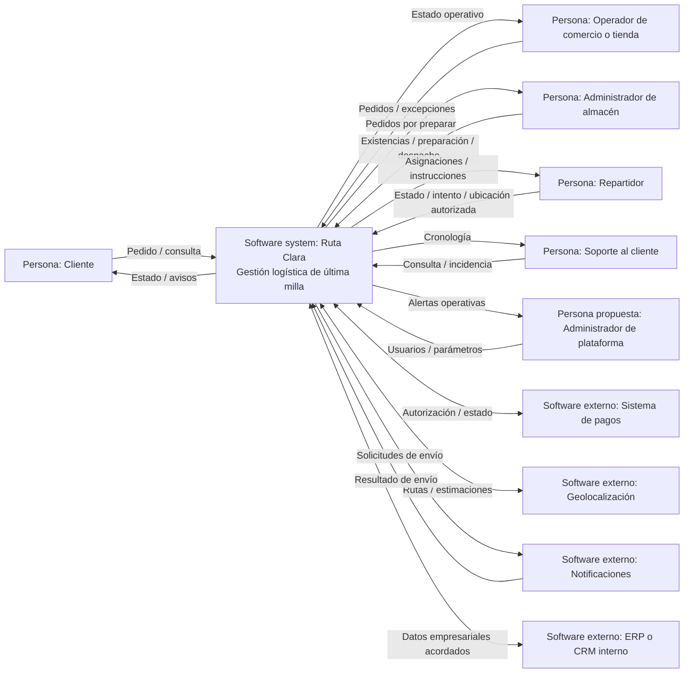

# Diagrama de contexto

Diagrama C4 de contexto (nivel 1). El sistema bajo análisis es Ruta Clara, una propuesta de plataforma centralizada de gestión logística. Las flechas representan intercambios conceptuales, no protocolos ni integraciones confirmadas.

Las integraciones se deben validar con la empresa. Para la propuesta técnica y el diagrama AWS, consulta [arquitectura-aws.md](arquitectura-aws.md).
