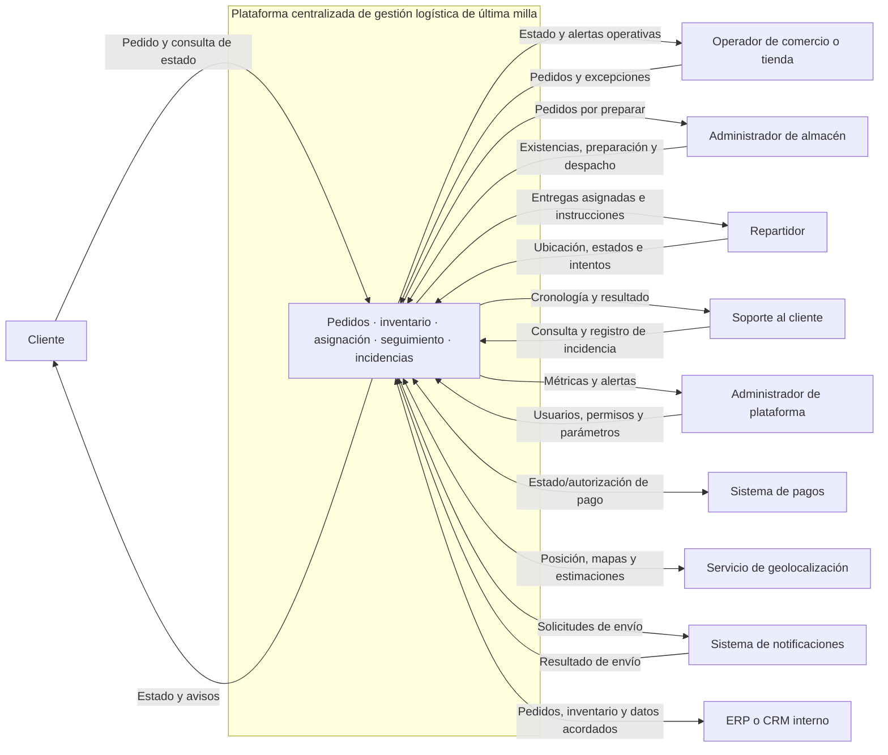

# Diagrama de contexto

El rectángulo principal representa la plataforma bajo análisis. Las flechas indican intercambios de información a nivel de contexto; no definen protocolos ni APIs.

## Lectura del diagrama

- Los participantes humanos usan la plataforma para registrar, ejecutar o consultar el flujo.
- Las flechas bidireccionales representan intercambio en ambos sentidos; las flechas simples muestran el flujo principal propuesto.
- Pagos, geolocalización, notificaciones y ERP/CRM son externos y su disponibilidad/contrato no se da por garantizado.
- Aún debe acordarse qué sistema es fuente maestra para pedido, inventario y datos de cliente.
